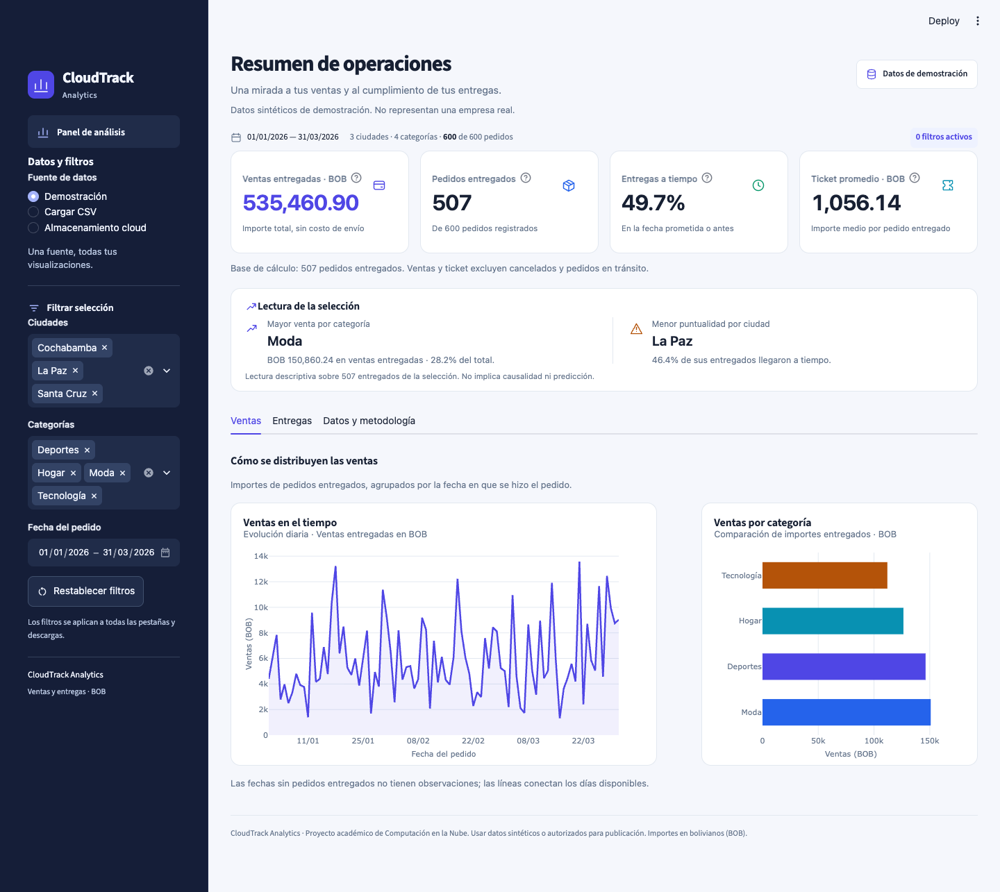

# CloudTrack Analytics

<p align="center">
  <strong>Analítica clara para ventas y entregas.</strong><br>
  Explora qué categorías y ciudades concentran las ventas y dónde se incumplen los plazos.
</p>

<p align="center">
  <a href="https://cloudtrack-analytics-exmcgfwkcp9hsubskacdnw.streamlit.app/">Abrir dashboard</a>
  &nbsp;·&nbsp;
  <a href="https://github.com/SatoJoe762/cloudtrack-analytics">Ver repositorio</a>
  &nbsp;·&nbsp;
  <a href="docs/arquitectura.md">Leer arquitectura</a>
</p>

<p align="center">
  
  
  
  
</p>

<p align="center">
  
</p>

## El proyecto

CloudTrack Analytics es un proyecto académico de **Computación en la Nube** que convierte datos de pedidos en una vista práctica de ventas y cumplimiento de entregas. Está desarrollado por un equipo de cinco estudiantes.

El dashboard permite explorar datos de demostración, cargar un CSV propio o leer un archivo privado desde **Cloudflare R2**. La conexión real de lectura a R2 se validó el 22 de octubre de 2026; la demostración local funciona sin credenciales.

## Qué puedes analizar

- **Ventas:** importes entregados por fecha y categoría, expresados en bolivianos (BOB).
- **Entregas:** estados de pedidos, puntualidad por ciudad y días medios de entrega.
- **Indicadores:** pedidos registrados y entregados, ventas entregadas, ticket promedio y porcentaje puntual.
- **Filtros:** ciudad, categoría y fecha del pedido, aplicados a las vistas y descargas.
- **Fuentes:** datos sintéticos, carga local de CSV y almacenamiento privado en R2.
- **Exportación:** descarga del CSV filtrado para análisis adicional.

La demo incluye **600 pedidos sintéticos**, de enero a marzo de 2026, generados con semilla 42.

## Inicio rápido

Requiere Python 3.12 recomendado. Desde la carpeta del proyecto, crea un entorno e inicia la aplicación:

```bash
python3 -m venv .venv
source .venv/bin/activate
python -m pip install -r requirements-dev.txt
python -m streamlit run app.py
```

Abre la dirección local que indique Streamlit, normalmente <http://localhost:8501>. Los datos de demostración están incluidos; puedes comenzar sin configurar una cuenta cloud.

En Windows PowerShell, crea y activa el entorno con:

```powershell
py -3.12 -m venv .venv
.venv\Scripts\Activate.ps1
```

Para ejecutar las pruebas:

```bash
python -m pytest -q
```

Para reproducir el entorno con las versiones exactas validadas, usa `requirements.lock.txt` en un entorno nuevo. El archivo lock incluye las herramientas de pruebas; actualízalo cuando cambien las dependencias.

## Arquitectura y tecnologías

| Capa | Tecnología | Uso |
|---|---|---|
| Aplicación | Python 3.12 · Streamlit | Interfaz interactiva y filtros |
| Datos | pandas | Validación, transformación y métricas |
| Gráficos | Plotly Express | Visualizaciones interactivas |
| Almacenamiento | Cloudflare R2 privado | Lectura del CSV remoto |
| Publicación | Streamlit Community Cloud | Despliegue conectado a GitHub |
| Calidad | pytest · GitHub Actions | Pruebas del contrato y validación de PR |
| Contenedor | Docker opcional | Ejecución portable |

El CSV es el conjunto de datos y pandas lo procesa en memoria; el proyecto no usa una base de datos. La guía de [arquitectura](docs/arquitectura.md) describe la separación entre cómputo y almacenamiento, el acceso de mínimo privilegio y la gestión de secretos.

## Estructura del proyecto

```text
cloudtrack-analytics/
├── app.py                       # Dashboard, filtros y fuentes
├── cloudtrack/
│   ├── analytics.py             # Validación y KPIs
│   ├── presentation.py          # Estilos y visualizaciones
│   └── storage.py               # Lectura de objetos en R2
├── assets/                      # Estilos y tokens visuales
├── data/orders_demo.csv         # Datos sintéticos
├── scripts/generate_demo.py     # Generador de datos de ejemplo
├── tests/                       # Pruebas de analítica, R2 y panel
├── docs/                        # Arquitectura, datos y despliegue
├── .github/workflows/ci.yml     # Integración continua
├── .streamlit/                  # Configuración y ejemplo de secretos
├── requirements*.txt            # Dependencias
└── Dockerfile                   # Imagen opcional
```

## Cloudflare R2

Para configurar la fuente remota, sigue la [guía de conexión a R2](docs/cloudflare-r2.md). Se necesita el endpoint de Cloudflare R2 y credenciales almacenadas como secretos; si la configuración está incompleta, el panel muestra instrucciones y no intenta conectarse a otro proveedor. No se requiere una cuenta AWS.

La plantilla local está en `.streamlit/secrets.toml.example`. **No subas secretos ni CSV con datos reales a Git.** La demo pública debe usar exclusivamente datos sintéticos o autorizados. La [validación de R2 y sus límites](docs/validacion.md) detalla qué se comprobó.

## Opcional: generar datos y usar Docker

```bash
python scripts/generate_demo.py
docker build -t cloudtrack-analytics .
docker run --rm -p 8501:8501 cloudtrack-analytics
```

Docker requiere estar instalado y puede necesitar configuración adicional en el entorno donde se ejecute.

## Colaboración

El repositorio del equipo es [SatoJoe762/cloudtrack-analytics](https://github.com/SatoJoe762/cloudtrack-analytics). Clona el proyecto y sigue [CONTRIBUTING.md](CONTRIBUTING.md) para trabajar en una rama y enviar un pull request:

```bash
git clone https://github.com/SatoJoe762/cloudtrack-analytics.git
cd cloudtrack-analytics
```

No hace falta crear otro repositorio ni versionar el entorno `.venv`. Las contribuciones e informes deben atribuirse según el trabajo realmente realizado.

## Alcance y limitaciones

El análisis es descriptivo y por lotes: no predice resultados ni captura pedidos en tiempo real. El estado de cada pedido es una fotografía, por lo que no hay historial de cambios. La puntualidad se calcula para pedidos entregados; los pedidos en tránsito pueden estar vencidos. Los filtros no permiten inferir causalidad. Se reportan importes en BOB, pero no se calcula utilidad o beneficio con solo el costo de envío.

Los CSV se validan como un conjunto completo para evitar exclusiones silenciosas; el límite de carga es 10 MB. La exportación conserva datos de entrada: trata archivos externos como contenido no confiable al abrirlos en hojas de cálculo. El panel no implementa autenticación propia; los filtros no controlan el acceso. El bucket privado protege el objeto, pero cualquier persona con acceso al dashboard puede ver los datos que este muestra.

## Documentación

- [Arquitectura cloud](docs/arquitectura.md)
- [Guía de Cloudflare R2](docs/cloudflare-r2.md)
- [Contrato de datos y fórmulas](docs/datos.md)
- [Despliegue](docs/despliegue.md)
- [Validación y límites](docs/validacion.md)
- [Pruebas del equipo](docs/pruebas-equipo.md)
- [Dashboard para la feria](docs/dashboard-feria.md)
- [Plan e informe](docs/plan-e-informe.md)

## Referencias

- [Streamlit Community Cloud](https://docs.streamlit.io/deploy/streamlit-community-cloud/deploy-your-app)
- [Streamlit: gestión de secretos](https://docs.streamlit.io/deploy/concepts/secrets)
- [Plotly Express](https://plotly.com/python/plotly-express/)
- [Cloudflare R2](https://developers.cloudflare.com/r2/)
