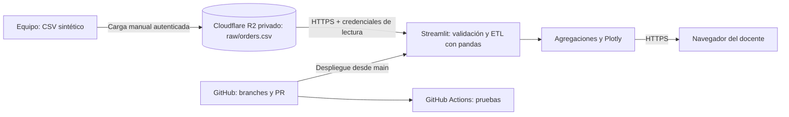

# Arquitectura implementada

El gráfico representa la ruta cloud comprobada el 22 de octubre de 2026. Streamlit leyó el objeto privado `cloudtrack-datos/raw/orders.csv` con credenciales de solo lectura almacenadas en Secrets. Ver [validación y captura](validacion.md). El ETL se ejecuta dentro de la aplicación en cada interacción: no hay Lambda, scheduler ni pipeline independiente.

## Relación con la materia

| Concepto | Implementación o evidencia esperada |
|---|---|
| Servicio administrado de aplicación | Streamlit Community Cloud ejecuta el panel |
| Almacenamiento de objetos | CSV persistente en R2, independiente del proceso |
| Identidad y acceso | Credencial de lectura limitada al bucket del proyecto; sin acceso público |
| Seguridad | HTTPS, secretos fuera del código, datos sintéticos |
| Automatización | Workflow de pruebas; despliegue conectado a main |
| Portabilidad | Dockerfile opcional; permite cambiar el hospedaje |
| Costos y operación | Registrar lecturas, tamaño, región, disponibilidad y alertas de gasto |
| Escalabilidad y límites | Procesamiento en memoria de máximo 10 MB; medir y discutir cuándo separar ETL o motor de consultas |

Cambiar un archivo en R2 cambia la fuente de la siguiente interacción del panel. Una carga en el navegador solo se analiza durante la sesión y no escribe en R2. El CSV conserva además una copia local; almacenar un objeto en la nube no sustituye una estrategia de respaldo.

## Variante si el docente exige IaaS o un solo proveedor

Ejecutar el contenedor en EC2, habilitar HTTPS con un proxy y asociar un rol IAM de lectura S3. Esta variante requiere administrar sistema, red, certificados y costos; es una ampliación documentada, no implementada en esta base. Para la entrega elegida, usar Community Cloud + R2 y justificar ambos servicios. La variante EC2/S3 queda fuera del alcance implementado.

## Experimentos para el informe

Medir tiempo de lectura y procesamiento con conjuntos sintéticos de tamaños crecientes dentro de 10 MB. Registrar entorno, tamaño, número de filas y varias repeticiones; no inventar latencias ni capacidad. Documentar que el almacenamiento R2 puede escalar independientemente mientras la aplicación sigue limitada por CPU y memoria del alojamiento. Concurrencia y tolerancia a fallos deben describirse como límites a menos que se prueben.

Configuración reproducible: [guía de Cloudflare R2](cloudflare-r2.md). El archivo s3-read-policy.json no se aplica a R2; se utiliza el permiso de lectura del token de Cloudflare.
