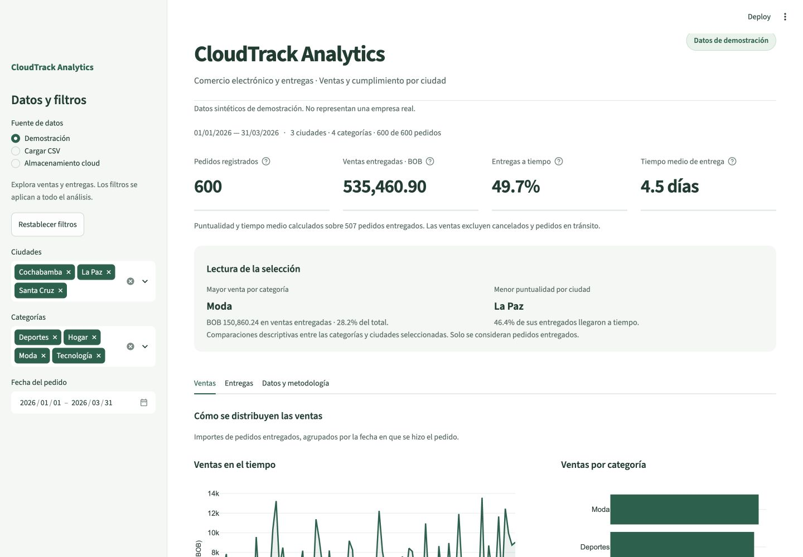
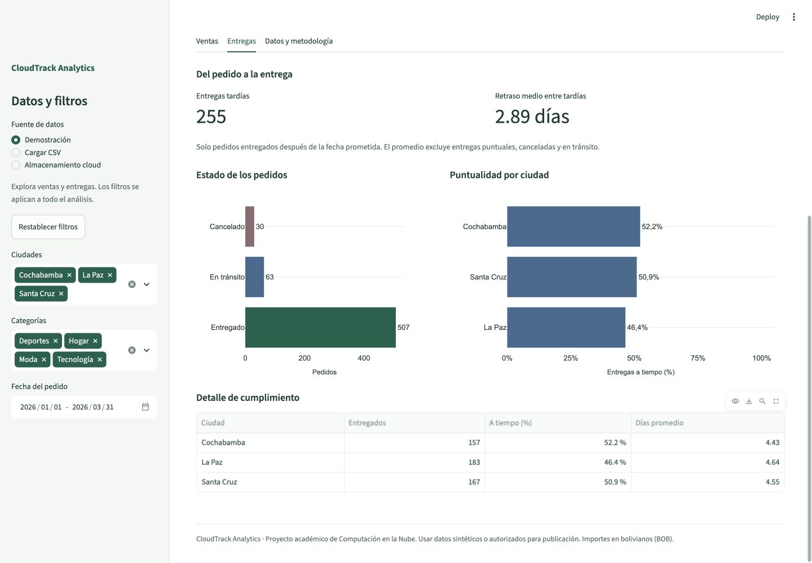
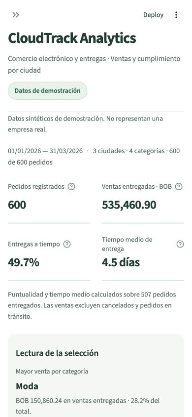

# Dashboard para la feria

La mejora conserva Streamlit y las fórmulas de ventas, puntualidad y retrasos. Cambia la presentación y agrega observaciones descriptivas para ayudar a explicar la selección.

## Qué cambia

- Fuente identificada como Demostración, CSV de esta sesión, Cloudflare R2 o Amazon S3 según la configuración. No se exponen claves ni nombres privados del endpoint.
- Indicadores con cuatro columnas en escritorio y dos en pantallas estrechas, sin truncar los importes.
- Lectura de la selección: categoría con mayor venta entregada y ciudad con menor puntualidad entre las seleccionadas. Los empates se muestran; ventas cero no produce una división inválida; sin entregados no se muestran conclusiones.
- Ventas con tendencia y distribución por categoría. Entregas con estados, comparación de puntualidad sobre una escala común de 0 a 100% y tabla verificable.
- Descargas CSV/JSON junto a la tabla de datos; metodología bajo un desplegable. Las notas explican denominadores y límites.
- Se mantienen filtros, validación, restablecimiento, fuente cloud de lectura y los nombres de las tres pestañas.

## Validación del diseño

- 53 pruebas locales aprobadas: las 52 existentes más el caso que verifica insights con filtros, empates, ventas cero y ausencia de entregados.
- Capturas locales en escritorio (1440 × 1000), móvil (390 × 844) y pestaña Entregas. En móvil se comprobó cuadrícula de dos columnas y ausencia de desbordamiento horizontal del documento.
- Revisión independiente de tres capturas y código. Se corrigió la opacidad heredada de los captions; el navegador confirmó color #536B62 con opacidad 1. El revisor dio por resuelto ese hallazgo, contraste aproximado 5,7:1 sobre blanco.
- Detector de diseño sin hallazgos; git diff --check correcto.
- Descargas reales desde el navegador local: CSV con 600 pedidos y JSON idéntico al resumen recalculado a partir de ese CSV.
- El mínimo de Streamlit pasa a 1.66, versión usada para comprobar width, contenedores con key y la presentación actual. No se añaden dependencias.

El PR #6 se integró y el nuevo diseño está publicado. Se comprobó lectura real de R2: 600 pedidos y BOB 535.460,90. Al filtrar La Paz, el panel y las descargas publicadas dieron 213 pedidos; el JSON coincidió con el resumen recalculado del CSV descargado. No se copiaron credenciales a local. Las capturas móviles no equivalen a pruebas en dispositivos físicos o con lectores de pantalla.

Durante la revisión publicada se detectó que restablecer filtros recuperaba los cálculos pero conservaba etiquetas visuales anteriores. Se corrigió asignando explícitamente los valores de sesión en vez de borrarlos; en navegador local se comprobó que las tres ciudades y los 600 pedidos se restablecen juntos. Las 53 pruebas siguen aprobadas.

## Guion breve para mostrarlo

1. Abrir Ventas y explicar fecha, fuente y filtros activos.
2. Mostrar categoría con mayor venta y comparar las barras con la observación.
3. Cambiar una ciudad y explicar que todos los resultados se recalculan.
4. En Entregas, distinguir puntualidad, tiempo de entrega y retraso entre tardías; contrastar porcentajes con la tabla.
5. En Datos y metodología, mostrar la validación y descargar los mismos datos que se están analizando.
6. Cambiar a Almacenamiento cloud para demostrar la separación entre la app y el archivo de R2. Identificar siempre el dataset sintético como académico.

## Capturas

## Carga CSV y configuración local de R2

El cargador de CSV ahora aparece en el área principal, junto con el ejemplo descargable y las instrucciones. En el navegador local se cargó el demo de 600 pedidos y se comprobó el rechazo de una copia sin order_id, sin mostrar resultados de éxito.

La fuente cloud se identifica siempre como Cloudflare R2. El lector exige bucket y endpoint R2 válidos; no intenta usar otro proveedor si falta el endpoint. Los nombres de configuración S3/AWS se conservan por compatibilidad con el SDK y los secretos ya desplegados, pero sus valores pertenecen a Cloudflare.

Se configuró la conexión local en .streamlit/secrets.toml, con permisos 600 y exclusión de Git. Se reinició Streamlit y se verificó lectura real de 600 pedidos desde R2. Las credenciales no se incluyen en la documentación ni en capturas. La preparación pasa 54 pruebas, incluido el rechazo de una configuración sin endpoint antes de crear un cliente.
