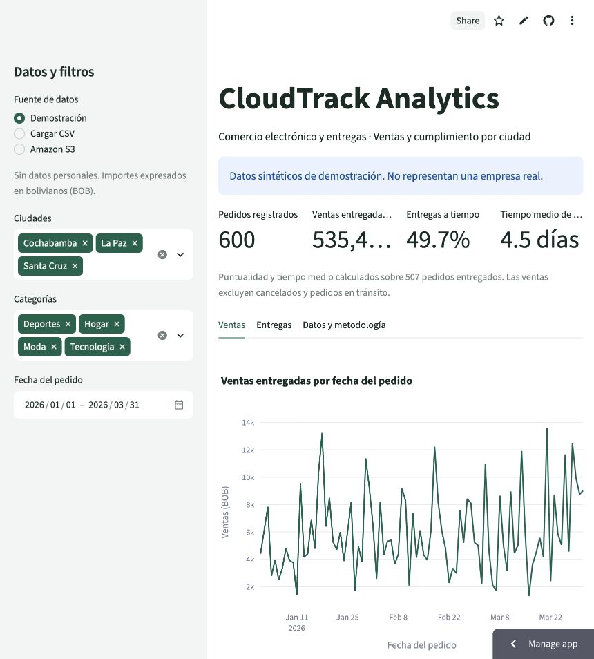

# Demostración publicada

Fecha de verificación: 21 de octubre de 2026 (America/La_Paz).

- URL: https://cloudtrack-analytics-exmcgfwkcp9hsubskacdnw.streamlit.app/
- Alojamiento: Streamlit Community Cloud.
- Repositorio: SatoJoe762/cloudtrack-analytics.
- Rama desplegada: main.
- Commit en main al publicar: bd0405cc5161c5cd2667b10e86871c06f40e8a50.
- Archivo principal: app.py.
- Python seleccionado en la publicación: 3.12.
- Datos: CSV sintético incluido en GitHub; sin credenciales AWS configuradas.

## Comprobaciones realizadas en la aplicación remota

| Caso | Resultado observado |
|---|---|
| Demo, todas las ciudades y categorías | 600 pedidos, ventas entregadas BOB 535.460,90, puntualidad 49,7 %, entrega media 4,5 días |
| Excluir Cochabamba, conservando La Paz y Santa Cruz | 414 pedidos, ventas entregadas BOB 373.795,68, puntualidad 48,6 %, entrega media 4,6 días |
| Pestaña Entregas | Gráfico de estados y tabla por ciudad visibles |
| Permisos para compartir | Opción Make this app public activada en el diálogo Share |

Los resultados fueron observados en el navegador sobre la URL desplegada. La disponibilidad permanente y la concurrencia del equipo no se han medido. La captura muestra la demo con sus filtros iniciales.

## Qué sigue pendiente

- Integrar la rama docs/equipo-y-despliegue mediante un PR revisado para que esta documentación aparezca en main.
- Invitar al equipo al repositorio y repartir las tareas iniciales.
- Pedir a un compañero que abra el enlace desde su dispositivo y registrar el resultado.
- Crear y validar S3 privado con mínimo privilegio; la publicación actual no demuestra todavía almacenamiento externo en AWS.

La URL permite probar la aplicación; para colaborar en código cada integrante debe clonar el repositorio y trabajar mediante ramas y PR. Los cambios de código integrados en main serán la fuente de futuras actualizaciones del despliegue.
