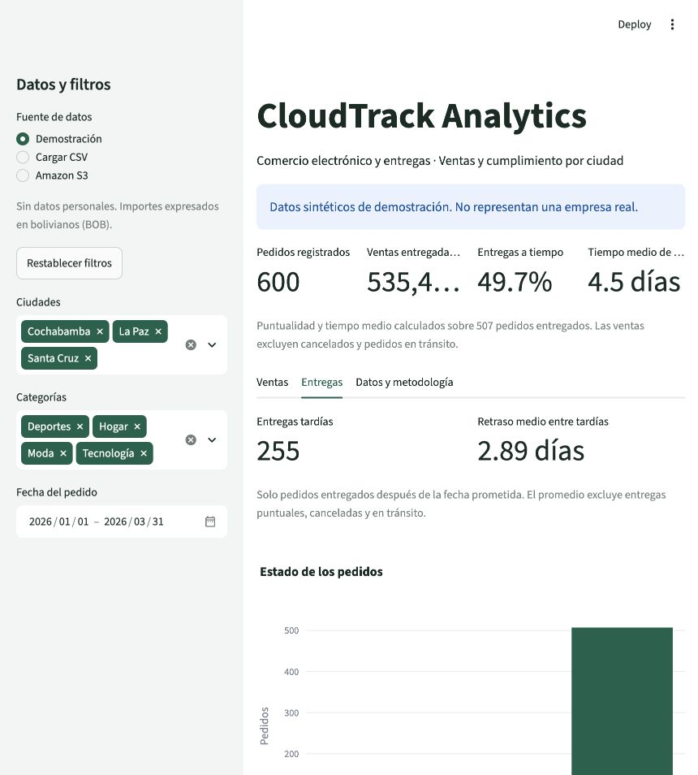

# Reporte histórico de la referencia cloud original

Resultado obtenido el 21 de octubre de 2026 con los 600 pedidos sintéticos originales, conservados en `data/orders_cloud_reference.csv`. La demo local actual tiene 100 pedidos distintos; este reporte no describe sus resultados ni garantiza que R2 siga conteniendo el archivo original. Es un análisis académico, no de una empresa real.

## Cómo reproducirlo

Desde la raíz del repositorio:

```bash
.venv/bin/python -m scripts.quality_report data/orders_cloud_reference.csv
.venv/bin/python -m scripts.quality_report data/orders_cloud_reference.csv --json
```

En Windows reemplazar el ejecutable por `.venv\Scripts\python.exe`. El [JSON de referencia](reporte-demo.json) registra el resultado completo. Si cambian el CSV, regenerar ese archivo y actualizar este documento; no presentar el ejemplo como un resultado de datos nuevos.

## Calidad y cobertura

- Contrato CSV: válido; no se descartaron filas.
- Pedidos: 600.
- Rango de fechas del pedido: 2026-01-01 a 2026-03-31.

### Ciudades

| Valor | Pedidos |
|---|---:|
| Cochabamba | 186 |
| La Paz | 213 |
| Santa Cruz | 201 |

### Categorías

| Valor | Pedidos |
|---|---:|
| Deportes | 168 |
| Hogar | 137 |
| Moda | 157 |
| Tecnología | 138 |

### Estados

| Valor | Pedidos |
|---|---:|
| cancelado | 30 |
| en_transito | 63 |
| entregado | 507 |

## Qué podemos explicar en la defensa

1. **¿Cuántos pedidos se entregaron y cuántos se atrasaron?** De los 600 pedidos, 507 están entregados y 255 de esos entregados llegaron después de la fecha prometida. No se evalúan cancelados o en tránsito como si ya hubieran terminado.
2. **¿Cuánto se atrasaron quienes llegaron tarde?** El promedio entre los 255 tardíos es 2,89 días calendario. Esta cifra compara entrega real con prometida; no es el tiempo desde que se hizo el pedido.
3. **¿Qué ciudad tiene más pedidos en el conjunto demo?** La Paz tiene 213 pedidos, Santa Cruz 201 y Cochabamba 186. Es un conteo de todos los estados; no un ranking de ventas ni de puntualidad.

La puntualidad existente del panel es 49,7 % entre entregados y las ventas entregadas suman BOB 535.460,90. El cálculo de retrasos conserva esas fórmulas y el formato original de metrics().

## Cómo conectarlo con el rediseño

La función `delay_metrics(df)` de cloudtrack/analytics.py acepta el mismo DataFrame validado y filtrado que usa el dashboard. Devuelve `late_deliveries` y `average_delay_days`. Si no hay tardíos, el promedio es None; la interfaz deberá mostrar “Sin entregas tardías”. Los nuevos resultados ya aparecen en la pestaña Entregas de app.py, manteniendo la presentación nativa de Streamlit.

El reporte analiza el CSV completo recibido. En el dashboard se filtran las filas antes de llamar a delay_metrics. El reporte JSON descargable también usa exactamente esa selección.

## Límites

Un archivo que cumple el contrato puede contener datos que no sean reales. El control valida consistencia, no autenticidad. El estado es una fotografía y no permite reconstruir qué pedidos estaban pendientes en una fecha pasada. Este reporte local por sí solo no demuestra lectura cloud. La lectura real de R2 se comprobó por separado; ver [validación del despliegue](validacion.md).


## Verificación de integración al panel

El 22 de octubre de 2026 pasaron 43 pruebas locales, incluidas pruebas de indicadores, filtros, restablecimiento y cambio de conjunto de datos. En el navegador local, la pestaña Entregas mostró 255 tardíos y 2,89 días con la selección completa. Esta verificación corresponde a la rama de trabajo; el despliegue público solo recibe estos cambios después de integrarlos en main.


