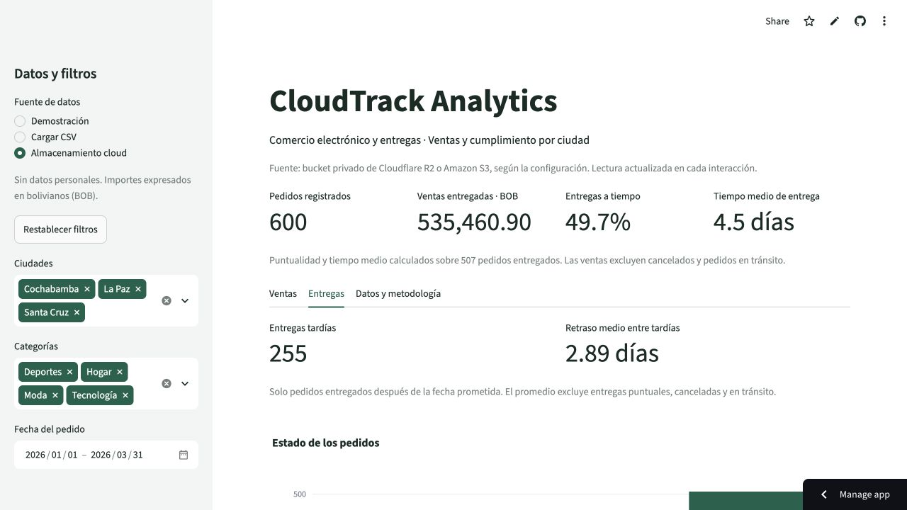

# Validación del proyecto

## Integración real comprobada — 22 de octubre de 2026

- Aplicación: [CloudTrack Analytics](https://cloudtrack-analytics-exmcgfwkcp9hsubskacdnw.streamlit.app/), repositorio `SatoJoe762/cloudtrack-analytics`, rama main, entrada `app.py`.
- Soporte R2 integrado mediante [PR #3](https://github.com/SatoJoe762/cloudtrack-analytics/pull/3), merge `eb7aa5185172c308c2e873187984ecb28d51aaf3`; GitHub mostró 1/1 checks aprobados. El commit identifica la integración en Git, no una inspección del SHA dentro del proceso alojado.
- Bucket `cloudtrack-datos`, clase Standard y acceso público deshabilitado; archivo sintético subido como `raw/orders.csv` (49.728 bytes).
- Credencial `cloudtrack-streamlit-lectura`: Object Read only, alcance exclusivo al bucket. Claves guardadas en Secrets de Streamlit, fuera de Git. Se creó sin vencimiento; revisar o revocar al terminar el curso.
- Tras guardar Secrets y reiniciar, desapareció un error de importación observado en el despliegue. La lectura real se verificó seleccionando Almacenamiento cloud, con todas las ciudades, categorías y fechas.

| Indicador | Demo y lectura real de R2 |
|---|---:|
| Pedidos | 600 |
| Ventas entregadas (BOB) | 535.460,90 |
| Entregados usados como denominador | 507 |
| Puntualidad | 49,7 % |
| Tiempo medio de entrega | 4,5 días |
| Entregas tardías | 255 |
| Retraso medio entre tardías | 2,89 días |

La selección de fuente y los indicadores se observaron en el navegador. La captura documenta una comprobación puntual; no es una medición de disponibilidad continua ni una prueba de concurrencia. Los datos son sintéticos y los mismos resultados se contrastaron en modo Demostración.

## Pruebas automatizadas e historial

La preparación de R2 pasó 52 pruebas locales: contrato CSV, fórmulas, filtros, reportes, panel y lectura cloud simulada. Las respuestas simuladas verifican el código; la comprobación del navegador anterior valida adicionalmente la conexión con la cuenta real.

La base inicial pasó 28 pruebas en Python 3.12.14 y 3.13 y pip check en Python 3.12. Posteriormente pasó 43 pruebas al integrar filtros y retrasos; esos conteos son históricos. Las versiones del entorno local se registraron en requirements.lock.txt. No se volvió a ejecutar la suite para esta actualización de documentación, que no cambia código.

## Pendientes de cierre

- [ ] Ejecutar y registrar las [pruebas del equipo](pruebas-equipo.md) desde otros dispositivos.
- [x] Guardar alerta de presupuesto en Cloudflare con umbral USD 1 y aviso al correo de la cuenta. La consola confirmó «Budget alert saved successfully». No se ha provocado un cargo ni verificado la recepción de un correo; la alerta no establece un tope de consumo.
- [ ] Verificar descargas y archivos inválidos en la aplicación publicada con evidencia del equipo.
- [ ] Medir rendimiento o concurrencia solo si lo pide el alcance del curso; no se dispone aún de esas mediciones.
- [ ] Completar informe, contribuciones y ensayo de defensa.

Docker sigue siendo una alternativa incluida: la imagen no se construyó en la validación inicial. No se comprobó una cuenta AWS ni se desplegó EC2. La conexión R2 publicada no configura automáticamente secretos en los equipos locales de los integrantes.

## Revisión operativa del 22 de octubre de 2026

Comprobaciones realizadas por el asistente en el navegador integrado; no sustituyen la revisión del equipo desde otros dispositivos.

- El PR #4 de documentación está integrado en main y GitHub mostró una comprobación aprobada.
- Cloudflare mostró USD 0,00 facturables, 49,8 KB almacenados, 22 operaciones clase A y 4 clase B en el momento de la consulta. Los contadores pueden actualizarse con retraso y cambiar tras las pruebas.
- Se guardó la alerta «CloudTrack R2 — aviso de gasto», umbral USD 1, con destinatario el correo de la cuenta. No se publican datos de contacto en este registro.
- En una sesión nueva de la aplicación publicada, la demo mostró 600 pedidos. Al filtrar solo La Paz mostró 213.
- Al cambiar de esa selección a Almacenamiento cloud, el panel recuperó 600 pedidos.
- Al quitar todas las ciudades mostró «No hay pedidos con estos filtros». Restablecer filtros recuperó 600 pedidos y conservó la fuente cloud.

Siguen pendientes las descargas y cargas de CSV en la aplicación publicada, y la revisión en dispositivos del equipo. No se modificó código ni se volvió a ejecutar la suite para esta actualización documental.
